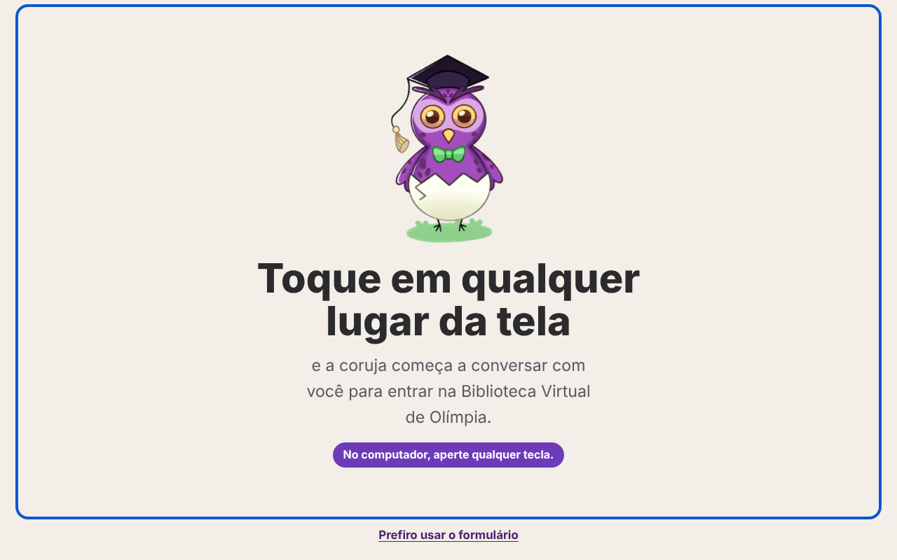

# 🦉 Biblioteca Virtual de Olímpia

> Um site de leitura pensado desde o início para quem tem deficiência visual, auditiva ou dificuldade de leitura. Uma coruja conversa com a pessoa por voz, do login até a leitura.

🔗 **Acesse:** https://n-safra.github.io/biblioteca-virtual/



## Sobre o projeto

Projeto integrador do 1º semestre de **Desenvolvimento de Software Multiplataforma (FATEC)**, nas disciplinas de Design Digital e Engenharia de Software, apresentado na Feira de Tecnologia da FATEC. Feito em grupo.

A pergunta que guiou o projeto: **como uma pessoa cega entra numa biblioteca virtual se quase todo login depende de enxergar a tela?**

## O que ele faz

**Entrada sem precisar enxergar**
- Basta tocar em qualquer lugar da tela (ou apertar qualquer tecla) para a coruja começar a conversar por voz.
- O login é feito conversando, com uma entrada por digital (simulada, porque o projeto é só front-end) ou um código de seis números falado.

**Painel de acessibilidade**
- Tamanho da letra (A−, A, A+), tema escuro e alto contraste.
- Voz da coruja com velocidade lenta, normal ou rápida, e a tecla Esc para parar a leitura.
- Janela de intérprete de Libras.

**Assistente de leitura adaptativa**
- A coruja responde a perguntas sobre o trecho que a pessoa está lendo.
- Ela observa como a pessoa lê e se adapta: se a pessoa pergunta o significado de várias palavras, oferece o texto em linguagem simples; se pede para repetir, oferece falar mais devagar.
- **Ela sempre pergunta antes de mudar algo.** Tudo o que mudou aparece num cartão, com o motivo e um botão para desfazer.

## Como funciona por dentro

- **HTML, CSS e JavaScript puro**, sem framework e sem servidor.
- **Voz:** Web Speech API do navegador (`speechSynthesis` para falar e `SpeechRecognition` para ouvir).
- **A coruja não usa inteligência artificial.** Ela procura palavras-chave na pergunta e busca a resposta numa base de conhecimento escrita à mão (`js/conhecimento.js`). Foi uma escolha consciente: o projeto não tinha chave de API, e assim as respostas são previsíveis e nunca inventam informação sobre o livro.

```
index.html
css/style.css
js/script.js        → navegação, login por voz, painel de acessibilidade
js/assistente.js    → assistente de leitura adaptativa
js/conhecimento.js  → base de conhecimento da coruja
static/images/      → a coruja
```

## Como rodar

Abra o `index.html` num navegador. O reconhecimento de voz funciona melhor no **Chrome** ou no **Edge** e pede permissão para usar o microfone.

## Limitações

- É um protótipo de front-end: não há banco de dados, e a digital é uma simulação.
- O reconhecimento de voz depende do navegador e não funciona em todos.
- A coruja só responde ao que está na base de conhecimento.

## Equipe

Projeto em grupo de sete estudantes do 1º semestre de DSM da FATEC.
Professores: Eric Magro (Design Digital) e Edson (Engenharia de Software).

Publicado por **Nicolas Safra Gazige**, integrante da equipe.
